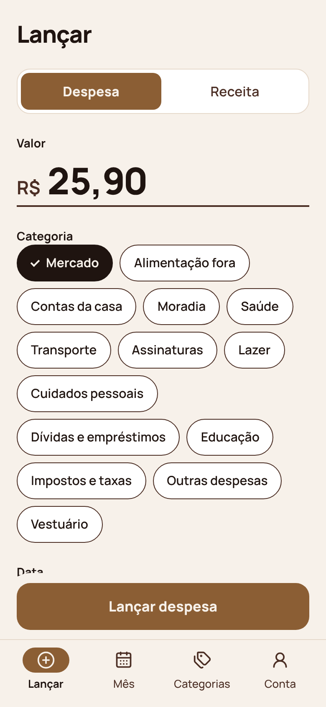
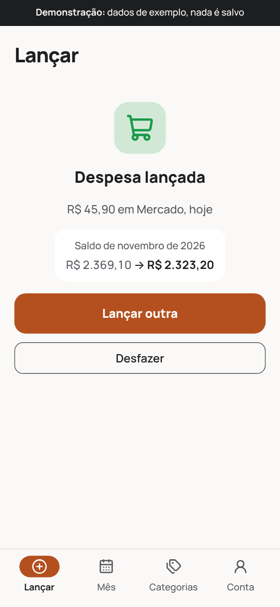
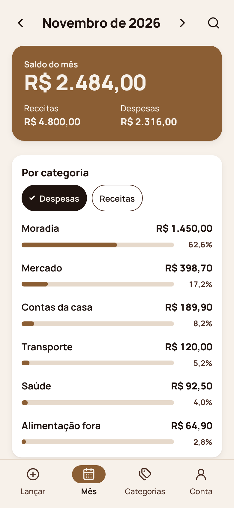
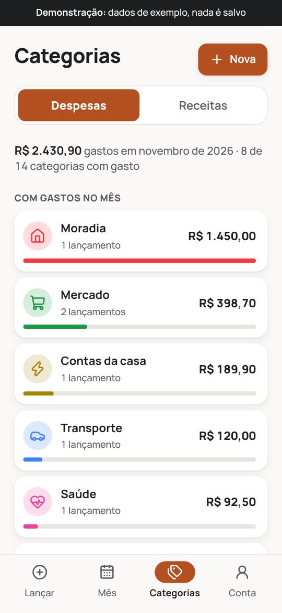
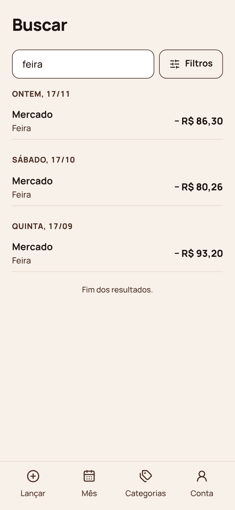
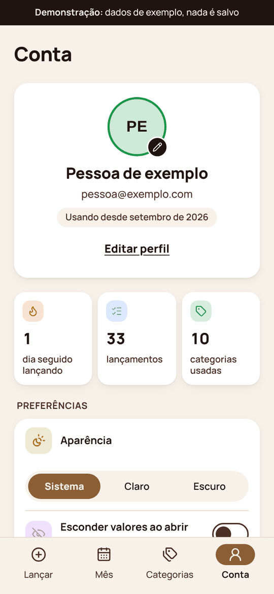
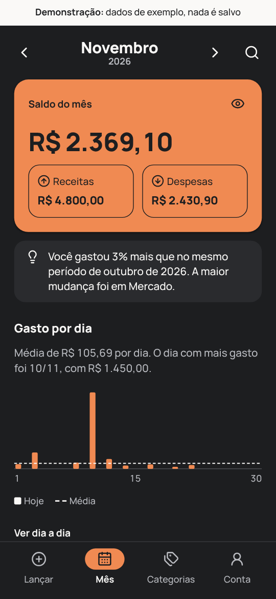
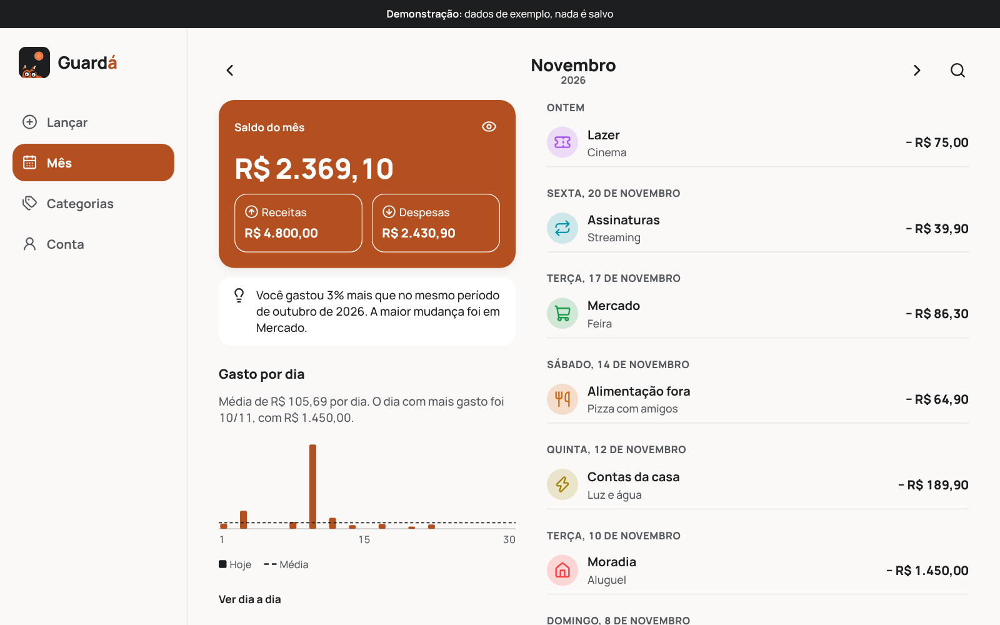
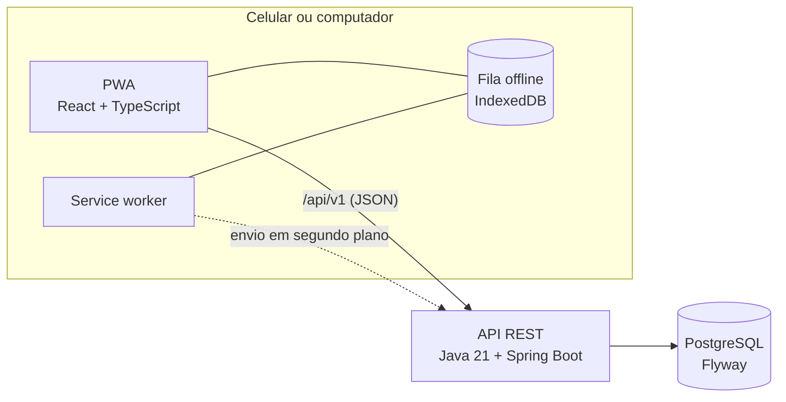

<div align="center">


# Easy Finance

**Anote seus gastos em segundos e veja para onde vai o seu dinheiro.**

Controle financeiro pessoal no celular ou no computador, sem planilha e sem complicação.

<a href="https://igorpacheco1.github.io/Easy-finance/"></a>

<sub>Abre no navegador, com dados de exemplo. Nada é salvo e não precisa criar conta.</sub>

[](https://github.com/IgorPacheco1/Easy-finance/actions/workflows/ci.yml)
[](LICENSE)

</div>

---

<table>
  <tr>
    <td align="center"></td>
    <td align="center"></td>
    <td align="center"></td>
    <td align="center"></td>
  </tr>
  <tr>
    <td align="center"><b>Lançar</b></td>
    <td align="center"><b>Pronto!</b></td>
    <td align="center"><b>Seu mês</b></td>
    <td align="center"><b>Categorias</b></td>
  </tr>
  <tr>
    <td align="center"></td>
    <td align="center"></td>
    <td align="center"></td>
    <td></td>
  </tr>
  <tr>
    <td align="center"><b>Buscar</b></td>
    <td align="center"><b>Seu perfil</b></td>
    <td align="center"><b>Tema escuro</b></td>
    <td></td>
  </tr>
</table>

<p align="center">
  
</p>

<sub>Imagens da demonstração, com dados de exemplo.</sub>

## Por que usar

- **Rápido de verdade.** Lançar é como usar uma calculadora: digite o valor, toque na categoria e
  pronto. As categorias que você mais usa aparecem primeiro.
- **Funciona sem internet.** Sem sinal, o lançamento fica guardado no aparelho e é enviado
  sozinho quando a conexão volta, sem duplicar.
- **Mostra o que importa.** Quanto sobrou no mês, para onde foi o dinheiro e se você está
  gastando mais ou menos que no mês anterior, sem fórmula nenhuma.
- **Seus dados são seus.** Não liga na sua conta do banco, não tem anúncio e não vende dados.
  Você vê só os seus lançamentos, e excluir a conta apaga tudo.
- **Para todo mundo.** Funciona no celular e no computador, tem tema claro e escuro, pode ser
  usado só pelo teclado e com leitor de tela.

## O que dá para fazer

- **Lançar** receitas e despesas em segundos, com **Desfazer** logo depois.
- **Acompanhar o mês:** saldo, gasto por dia, para onde foi o dinheiro (por categoria) e todos os
  lançamentos agrupados por dia. Um toque no olho esconde os valores da tela.
- **Corrigir ou excluir** qualquer lançamento.
- **Buscar** por texto, categoria, tipo, valor e período, em lançamentos de qualquer época.
- **Organizar categorias** com o seu ícone e a sua cor.
- **Personalizar:** seu nome, a cor do seu avatar, o tema e se o Mês abre com os valores
  escondidos.
- **Instalar como app** na tela inicial do celular ou do computador
  ([como instalar](docs/guias/instalar-o-app.md)).

O app está em evolução constante.

## Segurança e privacidade

- O app guarda só o que você informa: nome, e-mail, categorias e lançamentos. Não pede foto, CPF
  nem dados de banco.
- A senha é guardada de um jeito que ninguém consegue ler (hash BCrypt), e o login tem limite de
  tentativas.
- Cada pessoa só enxerga os próprios dados. Isso é conferido por testes automáticos que simulam
  duas pessoas usando o app ao mesmo tempo.
- No aparelho ficam só os lançamentos que ainda não foram enviados. Sair da conta apaga o que o
  app guardou nele.
- O app ainda não está publicado na internet; para conhecer, use a
  [demonstração](https://igorpacheco1.github.io/Easy-finance/).

Achou uma falha de segurança? Veja como avisar em [SECURITY.md](SECURITY.md).

## Para desenvolvedores

[](backend)
[](backend)
[](web)
[](backend)

Uma API REST em **Java 21 com Spring Boot**, com as regras de negócio, e um **PWA em React +
TypeScript** que só consome essa API.



| Pasta | O que tem |
|---|---|
| [`backend/`](backend) | API (Java 21, Spring Boot, Maven, PostgreSQL, Flyway): [README](backend/README.md) |
| [`web/`](web) | App (React 19, TypeScript, Vite, PWA): [README](web/README.md) |
| [`docs/`](docs) | Arquitetura, design system, ADRs e guias |
| [`legacy/prototype-sqlite`](legacy/prototype-sqlite) | Protótipo antigo em console (congelado) |

### Destaques técnicos

- **Nenhum lançamento duplicado:** o app gera o id de cada lançamento e a API é idempotente; um id
  excluído fica bloqueado (`410 Gone`), para um reenvio atrasado não trazer de volta o que foi
  apagado.
- **Offline de verdade:** fila no IndexedDB, envio em segundo plano com Background Sync e service
  worker próprio ([ADR-0019](docs/adr/0019-lancamento-offline.md)).
- **Dinheiro sem erro de arredondamento:** `BigDecimal` no Java e `NUMERIC(19,2)` no banco
  ([ADR-0007](docs/adr/0007-representacao-de-dinheiro.md)).
- **Testes em três camadas:** unidade, HTTP (`@WebMvcTest`) e integração com PostgreSQL real
  (Testcontainers); no app, testes de tela com Testing Library, API falsa (MSW) e acessibilidade
  com o axe em todas as telas. Cobertura mínima conferida no CI.
- **API documentada:** OpenAPI, erros em ProblemDetail (RFC 9457) com mensagens em português, e os
  tipos do app gerados a partir dela ([ADR-0028](docs/adr/0028-tipos-do-app-conferidos-no-ci.md)).
- **Processo:** GitHub Flow, Conventional Commits, CI obrigatório na `main`, [CHANGELOG](CHANGELOG.md)
  e mais de 30 [ADRs](docs/adr) explicando o porquê de cada decisão.

Mais em [`docs/architecture/overview.md`](docs/architecture/overview.md) e no
[design system](docs/design-system.md).

### Como rodar

Precisa de **JDK 21**, **Docker Desktop** e **Node 26**. Na primeira vez, siga
[Preparar o computador](docs/guias/preparar-o-computador.md). Depois, a partir da raiz do
repositório:

```bash
# 1. Banco (PostgreSQL)
docker compose up -d

# 2. API, em http://localhost:8080 (PowerShell: $env:SPRING_PROFILES_ACTIVE="dev"; ./mvnw spring-boot:run)
cd backend
SPRING_PROFILES_ACTIVE=dev ./mvnw spring-boot:run

# 3. App, em http://localhost:5173
cd web
npm install
npm run dev
```

Portas, uso pelo celular e solução de problemas: [Rodar o projeto](docs/guias/rodar-o-projeto.md)
e [celular com HTTPS](docs/guias/celular-com-https.md).

**Testes:** `cd backend && ./mvnw -B verify` (com o Docker aberto) e `cd web && npm test`.

### Como acompanhar e contribuir

- [Issues](https://github.com/IgorPacheco1/Easy-finance/issues),
  [CHANGELOG](CHANGELOG.md) e [releases](https://github.com/IgorPacheco1/Easy-finance/releases)
- Decisões: [ADRs](docs/adr) · Documentação: [`docs/`](docs)
- Como contribuir: [CONTRIBUTING.md](CONTRIBUTING.md)

## Licença

O código é **visível, mas de uso restrito**: está sob a
[PolyForm Noncommercial License 1.0.0](LICENSE). Em resumo (o texto da licença é o que vale):

- **Pode** ler, estudar, rodar e modificar para uso pessoal, estudo, pesquisa e outros fins **não comerciais**.
- **Não pode** usar para fins comerciais (vender, oferecer como produto ou serviço, usar numa empresa
  com fins lucrativos) sem permissão por escrito do autor.
- Quem distribuir cópias deve manter a licença e o aviso `Required Notice` do [LICENSE](LICENSE).

Esta licença **não é de código aberto** no sentido da OSI. Versões publicadas **antes** da troca
(até a v0.4.0) continuaram sob a licença MIT para quem já as recebeu; ver
[ADR-0023](docs/adr/0023-licenca-polyform-noncommercial.md). Para uso comercial, fale com o autor.

## Autor

**Igor Pacheco**, [@IgorPacheco1](https://github.com/IgorPacheco1)
