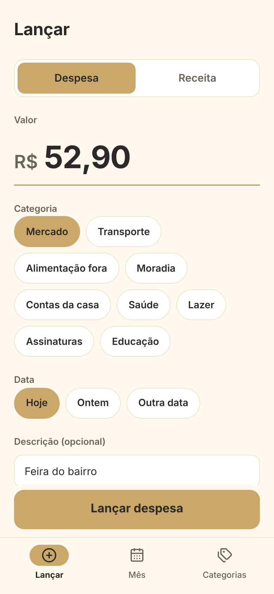
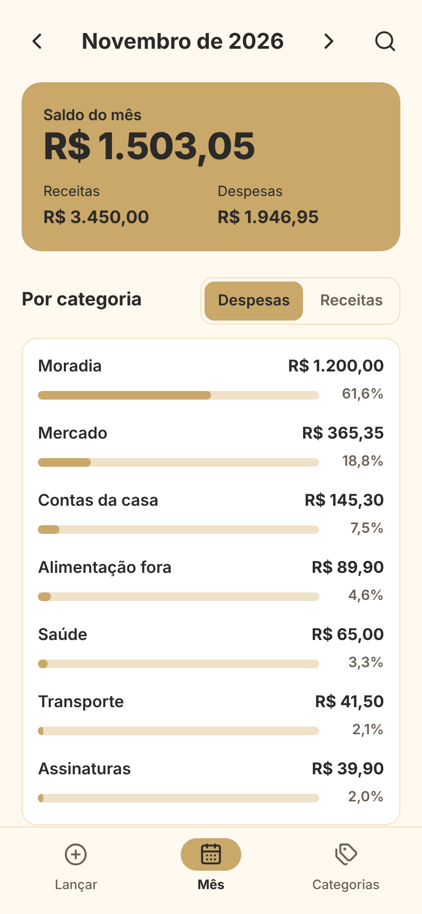
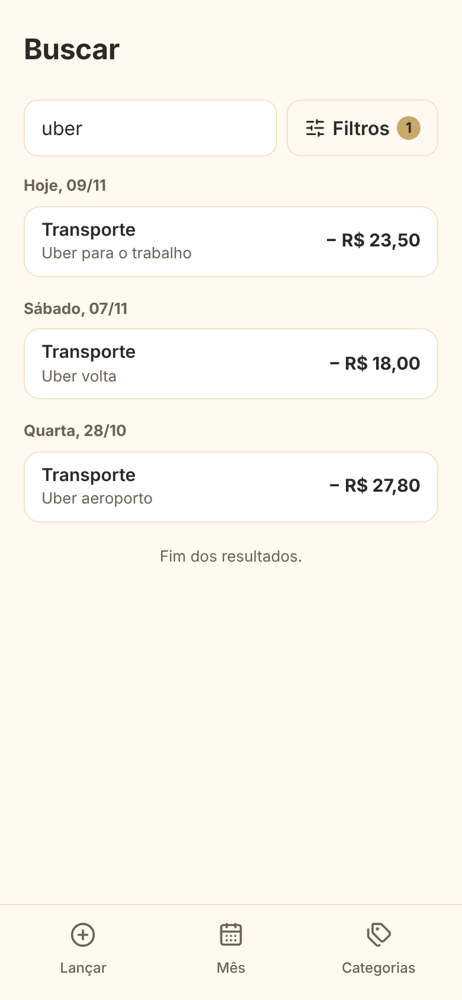
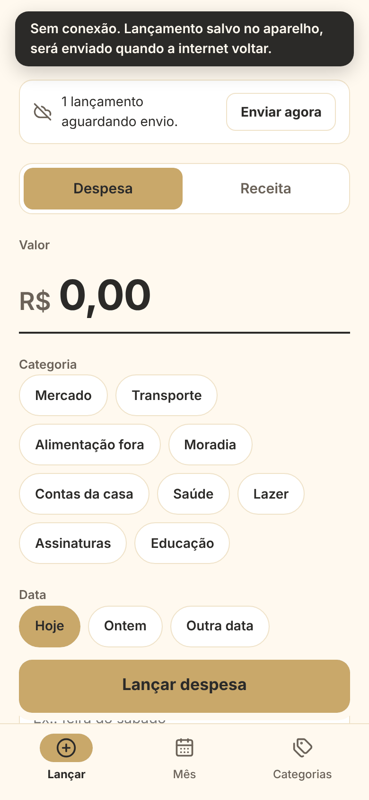
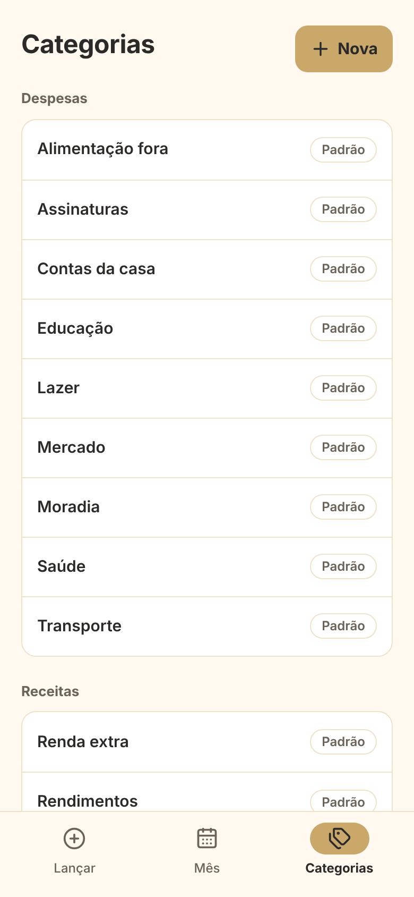
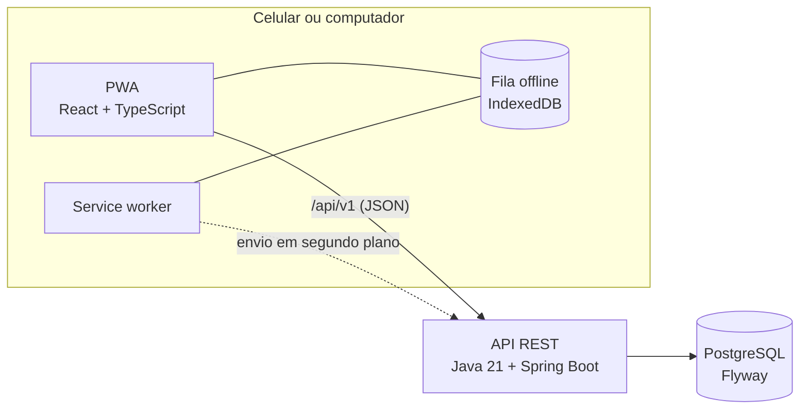

<div align="center">

# Easy Finance

**Controle financeiro pessoal para registrar receitas e despesas em segundos, no celular ou no computador.**

[](https://github.com/IgorPacheco1/Easy-finance/actions/workflows/ci.yml)
[](LICENSE)


</div>

---

## Por que este projeto existe

Manter uma planilha de gastos exige disciplina: abrir o arquivo, formatar, somar, conferir
fórmulas. O Easy Finance nasceu para tornar o registro de receitas e despesas **rápido, com foco no
celular**, e para responder perguntas simples sem fórmulas: *quanto sobrou no mês? onde estou
gastando mais?*

O projeto é pensado para ir para produção e é conduzido como um projeto profissional: todo
trabalho parte de uma issue, toda mudança entra por Pull Request com CI, e toda decisão de
arquitetura é registrada em um [ADR](docs/adr).

## O app

<table>
  <tr>
    <td align="center"></td>
    <td align="center"></td>
    <td align="center"></td>
    <td align="center"></td>
    <td align="center"></td>
  </tr>
  <tr>
    <td align="center"><b>Lançar</b></td>
    <td align="center"><b>Mês</b></td>
    <td align="center"><b>Buscar</b></td>
    <td align="center"><b>Sem internet</b></td>
    <td align="center"><b>Categorias</b></td>
  </tr>
</table>

<sub>Imagens com dados de exemplo.</sub>

## O que ele faz hoje (v0.4.0)

- **Lançamento rápido:** valor no estilo "caixa registradora", categoria em um toque (as mais
  usadas aparecem primeiro), data em Hoje/Ontem e descrição opcional, com **Desfazer**.
- **Funciona sem internet:** sem conexão, o lançamento fica guardado no aparelho e é enviado
  depois, sem duplicar. No Android e no computador, o envio acontece até com o app fechado.
- **Mês:** saldo, receitas e despesas, **resumo por categoria** com percentuais e a lista de
  lançamentos agrupada por dia, com rolagem infinita.
- **Busca:** por texto da descrição, tipo, categoria, faixa de valor e período, em lançamentos de
  qualquer época.
- **Categorias:** padrão do sistema e personalizadas (criar, renomear, excluir).
- **Instalável (PWA):** vai para a tela inicial do celular e abre como um app, com tema claro e
  escuro.

> Ainda **não há login** (chega no M5): por enquanto o app roda só no seu computador, com dados de
> teste. Veja [Segurança](#segurança).

## Destaques técnicos

- **Nenhum lançamento duplicado:** o app gera o id de cada lançamento, e a API é **idempotente**
  (reenviar o mesmo lançamento não cria uma cópia). Um id excluído fica bloqueado, para um
  reenvio atrasado não "ressuscitar" o que foi apagado (`410 Gone`).
- **Offline de verdade:** fila no IndexedDB, envio em segundo plano com Background Sync e um
  service worker próprio ([ADR-0019](docs/adr/0019-lancamento-offline.md)).
- **Dinheiro sem erro de arredondamento:** `BigDecimal` no Java e `NUMERIC(19,2)` no banco; toda
  soma é feita no PostgreSQL ([ADR-0007](docs/adr/0007-representacao-de-dinheiro.md)).
- **Testes em três camadas:** unidade, HTTP (`@WebMvcTest`) e integração com **PostgreSQL real**
  (Testcontainers, sem H2); no app, testes de tela com Testing Library e API falsa (MSW).
- **API documentada:** OpenAPI com Swagger UI, erros padronizados em ProblemDetail (RFC 9457)
  com mensagens em português, paginação e filtros combináveis (Specification).
- **Schema versionado:** só muda por migration Flyway; diagrama editável no
  [dbdiagram.io](docs/architecture/schema.dbml).
- **Processo:** GitHub Flow, Conventional Commits, CI obrigatório na `main`, milestones por
  versão, [CHANGELOG](CHANGELOG.md) e 19 [ADRs](docs/adr) explicando o porquê de cada decisão.

## Arquitetura



Uma API REST em **Java (Spring Boot)** com as regras de negócio, e um **PWA em React +
TypeScript** que só consome essa API. Detalhes em
[`docs/architecture/overview.md`](docs/architecture/overview.md),
[ADR-0002](docs/adr/0002-stack-backend.md) e [ADR-0005](docs/adr/0005-interface-pwa-react.md).

| Pasta | O que tem |
|---|---|
| [`backend/`](backend) | API (Java 21, Spring Boot, Maven, PostgreSQL, Flyway): [README](backend/README.md) |
| [`web/`](web) | App (React 19, TypeScript, Vite, PWA): [README](web/README.md) |
| [`docs/`](docs) | Roadmap, arquitetura, ADRs e guias |
| [`legacy/prototype-sqlite`](legacy/prototype-sqlite) | Protótipo antigo em console (congelado, tag `prototype-sqlite`) |

## Status e roadmap

| Milestone | Versão | Situação |
|---|---|---|
| M0: Fundação (repositório, CI, processo) | | ✅ Concluído |
| M1: Esqueleto do backend | v0.1.0 | ✅ Concluído |
| M2: API de categorias, transações e saldo | v0.2.0 | ✅ Concluído |
| M3: PWA mínimo | v0.3.0 | ✅ Concluído |
| M4: Consultas e offline | v0.4.0 | ✅ Concluído |
| M5: Segurança e multiusuário (cadastro, login, dados por usuário) | v0.5.0 | Próximo |
| M6: Produção (Docker, deploy, backups, monitoramento) | v1.0.0 | Planejado |

Depois do M5 vem uma etapa de acabamento visual. Detalhes no [roadmap](docs/roadmap.md) e nos
[milestones](https://github.com/IgorPacheco1/Easy-finance/milestones).

**Fora do escopo por enquanto:** microsserviços, multi-moeda, integração bancária (Open Finance)
e investimentos ([ADR-0004](docs/adr/0004-escopo-inicial.md)).

## Como rodar

Precisa de **JDK 21**, **Docker Desktop** e **Node 26**. Na primeira vez, siga
[Preparar o computador](docs/guias/preparar-o-computador.md) (instalações e o arquivo `.env`).
Depois, cada passo no seu terminal, a partir da raiz do repositório:

```bash
# 1. Banco (PostgreSQL)
docker compose up -d

# 2. API, em http://localhost:8080 (PowerShell: $env:SPRING_PROFILES_ACTIVE="dev"; ./mvnw spring-boot:run)
cd backend
SPRING_PROFILES_ACTIVE=dev ./mvnw spring-boot:run

# 3. App, em http://localhost:5173
cd web
npm install
npm run dev
```

Portas, uso pelo celular, IntelliJ e solução de problemas:
[Rodar o projeto](docs/guias/rodar-o-projeto.md). Para abrir no celular:
[com HTTPS](docs/guias/celular-com-https.md) e [instalar o app](docs/guias/instalar-o-app.md).

**Testes:** `cd backend && ./mvnw -B verify` (com o Docker aberto) e
`cd web && npm test`.

## Segurança

Proteger os dados financeiros guia as decisões do projeto. Hoje:

- Segredos só por variável de ambiente; o repositório tem apenas o `.env.example`.
- No ambiente local, o banco e a API só aceitam conexões do próprio computador.
- A API não devolve detalhes internos nos erros, não deixa respostas em cache e não grava dados
  financeiros no log; SQL sempre parametrizado; ids que não dá para adivinhar (UUID).
- O app não guarda respostas da API no aparelho; offline, só ficam os lançamentos ainda não
  enviados, apagados assim que o servidor confirma.

**Limitação conhecida:** ainda não há login. Até o M5, use só no seu computador e na rede de
casa, com dados de teste. Para relatar uma vulnerabilidade, veja [SECURITY.md](SECURITY.md).

## Como acompanhar

- **Trabalho em andamento:** [issues](https://github.com/IgorPacheco1/Easy-finance/issues) e o
  [project board](https://github.com/IgorPacheco1?tab=projects)
- **Histórico:** [CHANGELOG](CHANGELOG.md) e [releases](https://github.com/IgorPacheco1/Easy-finance/releases)
- **Decisões:** [ADRs](docs/adr) · **Documentação:** [`docs/`](docs)
- **Como contribuir:** [CONTRIBUTING.md](CONTRIBUTING.md)

## Licença

Distribuído sob a licença MIT. Veja [LICENSE](LICENSE).

## Autor

**Igor Pacheco**, [@IgorPacheco1](https://github.com/IgorPacheco1)
