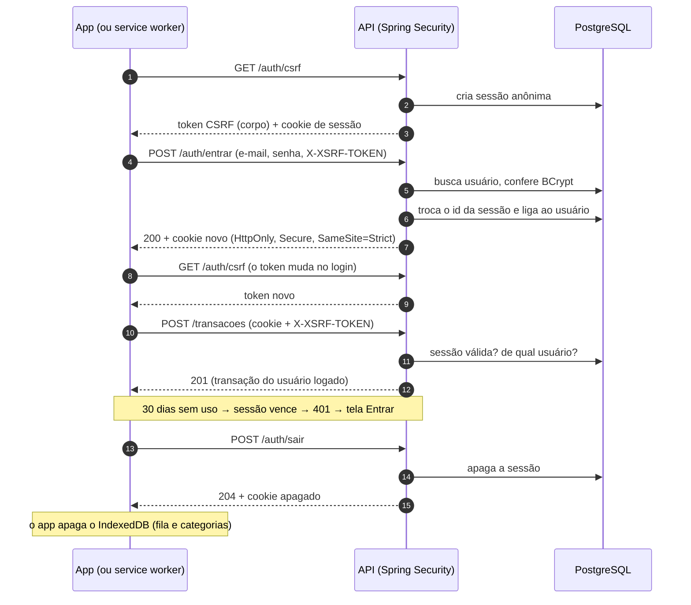

# ADR-0020: Autenticação com sessão no servidor e cookie

- **Status:** Aceita
- **Data:** 2026-11-10

## Contexto

Até o M4 a API não tem login: quem chega nela vê e altera tudo. O M5 traz contas de usuário, e
cada pessoa só pode ver os próprios dados financeiros. Este ADR é o resultado do spike (#122) e
decide **como o app prova quem é o usuário** em cada pedido (autenticação). Decidir **o que cada
usuário pode ver** (autorização, isolamento dos dados) fica para as issues de categorias e
transações, mas depende daqui.

Dois termos que aparecem o tempo todo:

- **Autenticação:** provar quem você é (e-mail e senha → "este é o Igor").
- **Autorização:** decidir o que você pode fazer depois disso ("o Igor pode ver esta transação?
  Só se for dele").

Restrições combinadas no planejamento do M5 (#121):

- O app é um PWA no **mesmo endereço** da API (`/` e `/api`, ver
  [overview](../architecture/overview.md)), sem CORS.
- A **fila offline** (ADR-0019) é reenviada também pelo **service worker**, com o app fechado.
- Dependências aprovadas: **Spring Security** e **Spring Session JDBC**.
- Proteção dos dados financeiros vem antes da comodidade, mas ninguém deve precisar logar toda
  vez que abre o app no celular.

## Decisão

### 1. Sessão no servidor, guardada no PostgreSQL

Funciona como a comanda de um restaurante: o navegador guarda só um **número aleatório e enorme**
(o id da sessão), num cookie; o servidor guarda **de quem é** aquele número.

- As sessões ficam numa tabela do PostgreSQL, pelo **Spring Session JDBC**. Reiniciar o backend
  não desloga ninguém, e o servidor consegue listar e encerrar as sessões de um usuário (usado em
  "trocar a senha" e "excluir a conta").
- As tabelas do Spring Session são criadas por **migration Flyway**, como todo o schema (nunca pelo
  script automático do Spring Session).
- **Duração:** a sessão expira depois de **30 dias sem uso** e se renova a cada pedido. Quem usa o
  app toda semana não precisa logar de novo; um aparelho esquecido desloga sozinho. O Spring
  Session apaga as sessões vencidas periodicamente.

### 2. O cookie da sessão

| Atributo | Valor | Por quê |
|---|---|---|
| `HttpOnly` | sim | O JavaScript da página não consegue ler o cookie. Se um dia alguém injetar um script no app (XSS), ele não rouba a sessão. |
| `Secure` | sim (fora do perfil `dev`) | O cookie só trafega em HTTPS. No `dev`, o `localhost` em HTTP também precisa funcionar. |
| `SameSite` | `Strict` | O navegador só envia o cookie em pedidos que saem do próprio Easy Finance. É a primeira defesa contra CSRF (abaixo). Não atrapalha: as chamadas à API sempre saem do próprio app; abrir o app por um link de fora carrega só a tela, que não tem dado nenhum. |
| `Path` | `/` | Vale para a API inteira. |

### 3. Proteção contra CSRF

**CSRF** é quando um site malicioso, aberto em outra aba, faz o navegador enviar um pedido para o
Easy Finance (por exemplo, um `POST` de transação). Sem proteção, o navegador anexaria o cookie de
quem está logado, e o servidor aceitaria um pedido que a pessoa nunca fez.

Duas defesas juntas (se uma falhar, a outra segura):

1. `SameSite=Strict` no cookie (acima).
2. **Token CSRF:** um segredo ligado à sessão, que o app manda no cabeçalho `X-XSRF-TOKEN` em
   todo pedido que altera dados (`POST`, `PUT`, `DELETE`). O site malicioso não consegue ler esse
   token, então não consegue montar o pedido.

Como o app recebe o token: pelo **corpo** de `GET /api/v1/auth/csrf`, e não por um cookie legível
pelo JavaScript. O token fica guardado **na sessão, no servidor** (padrão do Spring Security). Assim:

- o app e o **service worker** pegam o token do mesmo jeito (o service worker não lê cookies pelo
  JavaScript);
- nenhum segredo fica num cookie que o JavaScript consegue ler.

O app guarda o token **só em memória** e busca de novo: ao abrir, depois de entrar e sempre que a
API responder `403` por token CSRF inválido (uma única nova tentativa).

### 4. Entrar, sair e quem sou eu: endpoints JSON próprios

O login **não** usa o formulário pronto do Spring Security (`formLogin`), que responde com
redirecionamentos e páginas HTML. A API é JSON e os erros são ProblemDetail, então os endpoints são
nossos, usando as peças do Spring Security por baixo (`AuthenticationManager`,
`SecurityContextRepository` e `SessionAuthenticationStrategy`).

| Endpoint | Login? | O que faz |
|---|---|---|
| `GET /api/v1/auth/csrf` | não | Devolve o token CSRF da sessão atual (cria uma sessão anônima se não houver). |
| `POST /api/v1/auth/cadastro` | não | Cria a conta e **já deixa a pessoa logada** (menos um passo no celular). |
| `POST /api/v1/auth/entrar` | não | E-mail e senha → cria a sessão do usuário. |
| `POST /api/v1/auth/sair` | sim | Invalida a sessão no banco e apaga o cookie. |
| `GET /api/v1/eu` | sim | Dados do usuário logado; o app usa para saber se está logado. |
| `GET /actuator/health` | não | Health check (sem detalhes, como hoje). |
| OpenAPI e Swagger UI | não | **Só no perfil `dev`** (ADR-0010). |

**Todo o resto exige login.** A regra é "fechado por padrão": um endpoint novo nasce protegido, e
só entra na lista acima por decisão registrada.

- **Troca do id da sessão no login** (proteção contra *session fixation*): se alguém conseguiu
  plantar um id de sessão no navegador da vítima antes do login, esse id deixa de valer quando ela
  entra. É o padrão do Spring Security; um teste garante que continua assim.
- Depois de entrar (ou de se cadastrar), o token CSRF também muda; o app busca o novo.

### 5. Respostas de erro

| Situação | Status | Mensagem (ProblemDetail, em português) |
|---|---|---|
| Sem login ou sessão vencida | `401` | "Entre na sua conta para continuar." |
| E-mail ou senha errados | `401` | "E-mail ou senha inválidos." (sempre a mesma) |
| Token CSRF ausente ou inválido | `403` | "Sessão desatualizada. Tente de novo." |
| Muitas tentativas de login | `429` | Com `Retry-After` (issue do limite de tentativas) |
| Dado de outro usuário | `404` | Como se não existisse (issues de isolamento) |

**Login errado não revela se o e-mail existe:** a mensagem é a mesma, e o tempo de resposta
também. Quando o e-mail não existe, o servidor calcula um BCrypt "de mentira" mesmo assim; sem
isso, "e-mail inexistente" responderia em 1 ms e "senha errada" em 200 ms, e o tempo entregaria
quem usa o app.

### 6. Senhas

- Guardadas só como **hash BCrypt**, com *cost* **12** (cada +1 dobra o tempo da conta). O alvo é
  algo entre 0,1 e 0,3 s por verificação no servidor: imperceptível no login, mas torna inviável
  testar bilhões de senhas se o banco vazar. O SHA-256 foi descartado justamente por ser rápido.
- O BCrypt usa **sal**: a mesma senha gera hashes diferentes para pessoas diferentes.
- Gravado com o prefixo do algoritmo (`{bcrypt}$2a$12$...`, pelo `DelegatingPasswordEncoder` do
  Spring Security). Se um dia trocarmos de algoritmo (por exemplo, Argon2), as senhas antigas
  continuam funcionando e são atualizadas no próximo login.
- Regras: mínimo de **8 caracteres** e máximo de **72 bytes** (limite do BCrypt; acima disso, o
  resto seria ignorado sem aviso). Sem exigir símbolo ou número: senha longa protege mais que
  senha "complicada" e curta.
- A senha nunca aparece em log, resposta ou mensagem de erro.

### 7. Fila offline e service worker

- O service worker usa a mesma sessão do app (o cookie vai junto em pedidos do próprio endereço) e
  busca o token CSRF em `GET /auth/csrf` antes de enviar a fila.
- Resposta `401` ao reenviar (sessão vencida): o lançamento **continua pendente**, não é recusado.
  Ele é enviado depois que a pessoa entrar de novo.
- Cada lançamento da fila guarda o **id do usuário** que o fez. Se outra conta entrar no aparelho,
  os pendentes da conta anterior são **descartados, com aviso** (nunca enviados para a conta errada).
- **Sair** apaga o banco `easy-finance` inteiro do IndexedDB (fila e categorias). Se houver
  pendentes, o app avisa antes e oferece enviar ou descartar.

### 8. Fluxo

## Alternativas consideradas

- **Token JWT guardado pelo app:** muito usado e sem estado no servidor, mas o token ficaria
  acessível ao JavaScript (roubado por um XSS), revogar antes de vencer exige uma lista de tokens
  bloqueados (ou seja, estado no servidor de novo), e o service worker não teria acesso ao token
  para reenviar a fila. Faz sentido quando há muitos clientes diferentes (app nativo, terceiros);
  se um dia houver app nativo, ele pode ganhar um mecanismo próprio sem mudar o do PWA.
- **JWT dentro de um cookie `HttpOnly`:** resolve o XSS, mas mantém o problema de revogação
  (sair ou trocar a senha não derrubaria os outros aparelhos na hora) e não traz vantagem sobre a
  sessão para um único servidor.
- **Sessão na memória do servidor (padrão do Tomcat):** sem dependência nova, mas reiniciar ou
  atualizar o backend desloga todo mundo, e não dá para encerrar as sessões dos outros aparelhos.
- **Token CSRF num cookie legível pelo JavaScript** (`XSRF-TOKEN`, comum em SPAs): funciona no
  app, mas o service worker não lê cookies pelo JavaScript em todos os navegadores. O endpoint
  `GET /auth/csrf` serve aos dois do mesmo jeito.
- **`SameSite=Lax`:** o cookie também iria em links de outros sites. Não precisamos disso, pois o
  app não depende de chegar logado por um link externo.
- **Login pelo `formLogin` do Spring Security:** pronto, mas responde com redirecionamento e
  HTML, e não com JSON e ProblemDetail.

## Consequências

- Positivas:
  - O segredo da sessão nunca fica acessível ao JavaScript.
  - Sair, trocar a senha e excluir a conta derrubam as sessões na hora.
  - App e service worker autenticam do mesmo jeito.
  - Reiniciar o backend não desloga ninguém.
  - As peças críticas (hash, troca do id da sessão, CSRF) vêm prontas e testadas do Spring
    Security.
- Negativas / custos assumidos:
  - Duas dependências novas (Spring Security e Spring Session JDBC) e tabelas de sessão no banco.
  - Cada pedido consulta e atualiza a sessão no banco. Para o tamanho do app, é irrelevante; se um
    dia pesar, a sessão pode ir para um banco em memória (Redis) sem mudar o resto.
  - Visitantes sem login criam sessões anônimas (ao pedir o token CSRF). Elas vencem e são
    apagadas; o limite de requisições do M6 evita abuso.
  - O cadastro ainda revela se um e-mail já existe. Risco aceito até a confirmação por e-mail
    (M6); o limite de tentativas reduz o abuso.
  - Se um dia houver um app nativo ou a API em outro domínio, `SameSite=Strict` e a ausência de
    CORS precisam ser revistos (novo ADR).

## Verificação

- Testes (issues de login e de isolamento): sem login → `401` em todos os endpoints protegidos;
  `POST` sem token CSRF → `403`; id da sessão muda no login; sair invalida a sessão; login com
  e-mail inexistente e com senha errada dá a mesma resposta; cookie com `HttpOnly`, `Secure` e
  `SameSite=Strict` fora do perfil `dev`.
- Roteiro manual no celular (issue do app): entrar, lançar offline, fechar o app, voltar a
  conexão (no Android, o envio acontece em segundo plano, com a sessão), sair e conferir que o
  IndexedDB foi apagado.
