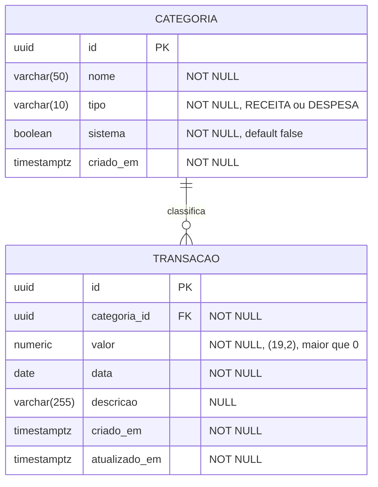
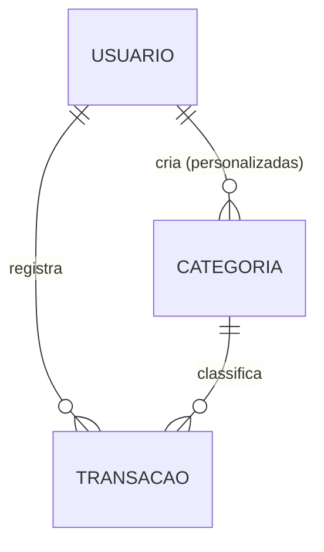

# Modelo de domínio

> **Status:** definido na issue #10 (M1) e implementado nas migrations Flyway
> [`V1__criar_tabelas_iniciais.sql`](../../backend/src/main/resources/db/migration/V1__criar_tabelas_iniciais.sql)
> e [`V2__inserir_categorias_do_sistema.sql`](../../backend/src/main/resources/db/migration/V2__inserir_categorias_do_sistema.sql) (#13).
> As entidades JPA chegam no M2, junto com os CRUDs.

Este documento define as entidades do Easy Finance, como elas se relacionam e **por que** cada
coluna e cada restrição existe. As decisões maiores estão registradas em ADR:

- [ADR-0006](../adr/0006-identificador-uuid.md): identificador UUID
- [ADR-0007](../adr/0007-representacao-de-dinheiro.md): dinheiro em `NUMERIC(19,2)` / `BigDecimal`
- [ADR-0008](../adr/0008-categorias-com-tipo-e-modelo-hibrido.md): categorias com tipo e modelo híbrido (sistema + personalizadas)

## Entidades (M1 a M4)

- **Categoria:** classifica um lançamento ("Mercado", "Salário"). Tem um **tipo** fixo: `RECEITA`
  ou `DESPESA`. Existem categorias do **sistema** (já vêm prontas) e, a partir do M5, categorias
  **personalizadas** de cada usuário.
- **Transação:** um lançamento de dinheiro que entrou ou saiu, numa data, com valor e descrição
  opcional. Pertence a **exatamente uma** categoria.

## Diagrama ER

O diagrama abaixo (Mermaid) aparece direto no GitHub. Para uma versão visual e editável, o schema
completo, com tipos, defaults, índices e `CHECK`, está em [`schema.dbml`](schema.dbml): é só colar
o conteúdo em [dbdiagram.io](https://dbdiagram.io). **Ao mudar o schema (nova migration), atualize
o `schema.dbml` no mesmo PR.** Quem manda no banco real são as migrations Flyway; o DBML é a
documentação visual delas.



Leitura: uma categoria classifica **zero ou muitas** transações; uma transação tem **exatamente
uma** categoria.

## Tabela `categoria`

| Coluna | Tipo | Nulo? | Por quê |
|---|---|---|---|
| `id` | `UUID` | não (PK) | Não é sequencial, então não dá para adivinhar ids alheios. Ver ADR-0006. |
| `nome` | `VARCHAR(50)` | não | Uma categoria sem nome não tem significado. 50 caracteres cabem bem na tela do celular. |
| `tipo` | `VARCHAR(10)` | não | `RECEITA` ou `DESPESA`. Fica na categoria para o app sugerir só as categorias certas em cada lançamento. Ver ADR-0008. |
| `sistema` | `BOOLEAN` | não | `true` para as categorias padrão, que o usuário não pode editar nem apagar. |
| `criado_em` | `TIMESTAMPTZ` | não | Auditoria básica. Instante em UTC. |

Restrições:

- `CHECK (tipo IN ('RECEITA', 'DESPESA'))`: o banco recusa qualquer outro valor, mesmo que um bug
  na API tente gravar.
- `CHECK (char_length(trim(nome)) > 0)`: impede nome vazio ou só com espaços.
- Nome único sem diferenciar maiúsculas: `UNIQUE INDEX ON categoria (lower(nome))`. Evita
  "Mercado" e "mercado" duplicados. No M5 essa regra passa a valer **por usuário** (ver abaixo).

Regra de negócio (Service): **o tipo de uma categoria não muda depois de criada.** Se mudasse,
todas as transações antigas dela trocariam de receita para despesa (ou o contrário) e o saldo
histórico mudaria sem ninguém perceber.

## Tabela `transacao`

| Coluna | Tipo | Nulo? | Por quê |
|---|---|---|---|
| `id` | `UUID` | não (PK) | Ver ADR-0006. Também permite criação idempotente na #19 (M2). |
| `categoria_id` | `UUID` | não (FK) | Toda transação tem categoria, então o usuário sempre sabe onde foi o dinheiro. |
| `valor` | `NUMERIC(19,2)` | não | Sempre **positivo**. Se é entrada ou saída, quem diz é o tipo da categoria. Ver ADR-0007. |
| `data` | `DATE` | não | O dia do lançamento, sem hora: "gastei no dia 10". Evita problemas de fuso horário. |
| `descricao` | `VARCHAR(255)` | sim | Opcional, para lançar rápido no celular ("Mercado" já basta). |
| `criado_em` | `TIMESTAMPTZ` | não | Quando o registro foi criado (UTC). É diferente de `data`. |
| `atualizado_em` | `TIMESTAMPTZ` | não | Quando foi alterado por último. Ajuda a investigar problemas. |

Restrições:

- `CHECK (valor > 0)`: valor zero ou negativo não tem significado. Sem isso, uma "despesa de -50"
  viraria uma receita disfarçada.
- `FOREIGN KEY (categoria_id) REFERENCES categoria (id) ON DELETE RESTRICT`: não dá para apagar
  uma categoria que ainda tem transações. Sem isso o histórico perderia a classificação.

### Por que a transação não tem coluna `tipo`

O tipo (receita ou despesa) **fica só na categoria**. Se ficasse nas duas tabelas, as duas
poderiam discordar: uma transação marcada como `RECEITA` dentro da categoria "Mercado", que é
`DESPESA`. Guardando a informação em **um lugar só**, essa inconsistência não tem como acontecer.

O saldo de um período fica assim:

```sql
SELECT COALESCE(SUM(CASE WHEN c.tipo = 'RECEITA' THEN t.valor ELSE -t.valor END), 0) AS saldo
FROM transacao t
JOIN categoria c ON c.id = t.categoria_id
WHERE t.data BETWEEN :inicio AND :fim;
```

Alternativa considerada: manter `tipo` também na transação e garantir no banco que os dois são
iguais, com uma FK composta `(categoria_id, tipo) → categoria (id, tipo)`. Funciona e evita o
`JOIN` no saldo, mas é mais complexo de entender e manter. Fica registrada caso o desempenho exija.

## Índices

| Índice | Por quê |
|---|---|
| PKs (`id`) | Criados automaticamente. |
| `transacao (data)` | A tela principal é "o mês": quase toda consulta filtra por período. |
| `transacao (categoria_id)` | O PostgreSQL **não** cria índice para FK automaticamente. Sem ele, o resumo por categoria e o `ON DELETE RESTRICT` precisam ler a tabela inteira. |
| `categoria (lower(nome))` único | Garante a unicidade do nome (ver acima). |

Índices têm custo (espaço e escrita mais lenta), por isso só entram os que têm uma consulta
prevista. No M5 o índice de data passa a ser `(usuario_id, data)`.

## Categorias do sistema

Carregadas por migration Flyway (dados, não só schema), com `sistema = true`. A lista se baseia na
[POF 2017-2018 do IBGE](https://agenciadenoticias.ibge.gov.br/agencia-sala-de-imprensa/2013-agencia-de-noticias/releases/25598-pof-2017-2018),
em que os maiores gastos das famílias brasileiras são habitação (36,6% do consumo), transporte
(18,1%), alimentação (17,5%), saúde (8,0%) e educação (4,7%).

**Despesas**

| Nome | Exemplos |
|---|---|
| Moradia | aluguel, condomínio, IPTU, manutenção |
| Contas da casa | luz, água, gás, internet, celular |
| Mercado | supermercado, feira, padaria |
| Alimentação fora | restaurante, lanche, delivery |
| Transporte | combustível, ônibus, aplicativo, estacionamento |
| Saúde | plano de saúde, farmácia, consultas |
| Educação | faculdade, cursos, livros, material |
| Vestuário | roupas, calçados, acessórios |
| Cuidados pessoais | higiene, cabeleireiro, academia |
| Lazer | cinema, viagens, passeios, jogos |
| Assinaturas | streaming, aplicativos, clubes |
| Dívidas e empréstimos | parcelas de empréstimo, financiamento, juros |
| Impostos e taxas | tarifas bancárias, IPVA, multas |
| Outras despesas | o que não se encaixa nas demais |

**Receitas**

| Nome | Exemplos |
|---|---|
| Salário | salário mensal, adiantamento |
| Renda extra | freelance, bicos, vendas |
| Benefícios | 13º, férias, auxílios, vale-alimentação |
| Rendimentos | juros de poupança, dividendos |
| Outras receitas | presentes, reembolsos, o que não se encaixa |

"Outras despesas" e "Outras receitas" existem porque a categoria é obrigatória: o usuário nunca
fica sem ter onde lançar.

## Como o usuário entra no modelo (M5, não implementar agora)



- Nova tabela `usuario` (id UUID, e-mail único, hash da senha, datas).
- `transacao.usuario_id UUID NOT NULL`: toda transação tem dono. **Toda consulta filtra por ele.**
- `categoria.usuario_id UUID NULL`: `NULL` = categoria do sistema (visível para todos);
  preenchido = categoria personalizada (visível só para o dono). A coluna `sistema` pode passar a
  ser derivada disso.
- A unicidade do nome passa a ser por usuário. Um usuário não pode criar uma personalizada com o
  mesmo nome de uma do sistema (validação no Service).
- Regra de isolamento: uma transação só pode usar categoria **do sistema ou do próprio usuário**.
- Isso exige uma migration nova (V2, V3...). As anteriores **nunca** são editadas.

## Perguntas em aberto (para issues futuras)

- Usuário poderá **ocultar** uma categoria do sistema que não usa? (M5)
- Transferência entre contas próprias conta como receita/despesa? Hoje não há contas; fica fora
  do escopo até um ADR dizer o contrário.
