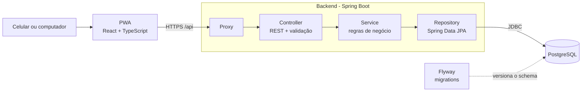

# Visão de arquitetura

> Este documento acompanha o que está implementado (v0.7.0). A Produção (hospedagem na internet)
> é o M7, ainda a planejar: o proxy de produção descrito abaixo ainda não existe.

## Visão geral

Monolito em camadas com API REST, banco relacional e um PWA mobile-first
([ADR-0005](../adr/0005-interface-pwa-react.md)).



Em produção o proxy entrega o PWA em `/` e a API em `/api` (mesmo domínio). Em desenvolvimento,
o servidor do Vite faz proxy de `/api` para o backend local.

## Estrutura do repositório

```
Guarda/
├── backend/    API Java (Spring Boot, Maven)
├── web/        PWA (React, TypeScript, Vite)
├── docs/       ADRs, arquitetura, design system, guias e roadmap
├── legacy/     protótipo SQLite congelado
├── tools/      scripts de configuração do GitHub (labels, milestones, issues)
└── compose.yaml  PostgreSQL local
```

## Responsabilidade das camadas (backend)

| Camada | Responsabilidade | Não deve |
|---|---|---|
| Controller | Receber HTTP, validar entrada, converter DTO ↔ domínio, devolver status corretos | Conter regra de negócio ou acessar o banco |
| Service | Regras de negócio, orquestração e transações | Conhecer detalhes de HTTP |
| Repository | Persistência e consultas | Conter regra de negócio |

## Organização de pacotes (backend, por funcionalidade)

Pacote base: `io.github.igorpacheco1.guarda`.

```
guarda/
├── auth/          entrar, cadastrar, sair, limite de tentativas, trocar senha e excluir conta
├── usuario/       entidade, perfil (nome e avatar) e quem é o usuário atual
├── estatisticas/  números do perfil
├── categoria/     controller, service, repository, entidade, DTOs
├── transacao/     controller, service, repository, entidade, DTOs (inclui saldo e resumos)
├── limites/       limites em memória: requisições e contas novas por IP
├── config/        configurações transversais (segurança, senhas, OpenAPI, relógio, cabeçalhos)
└── shared/        tratamento de erros e utilitários comuns
```

Organizar por funcionalidade (e não por camada técnica) mantém o que muda junto no mesmo lugar.

## Princípios

- **Dinheiro** é `BigDecimal` no Java e `NUMERIC(19,2)` no banco, nunca `double`.
- **Datas** de lançamento são `LocalDate`/`DATE`; instantes (criação) em UTC.
- **Identificador:** UUID v4 em todas as tabelas ([ADR-0006](../adr/0006-identificador-uuid.md)).
  Entidades e restrições em [`domain-model.md`](domain-model.md).
- **Schema** só muda por migration Flyway. Nunca por `ddl-auto`.
- **Erros** seguem `ProblemDetail` (RFC 9457), com título e mensagem em português, prontos para
  mostrar ao usuário. Erros de validação trazem também a lista `erros` (`campo` e `mensagem`).
  Nenhuma resposta expõe stack trace ou detalhes do banco. Ponto único: `shared/TratadorGlobalDeErros`.
- **API versionada** (`/api/v1/...`), porque o PWA instalado pode ficar desatualizado.
- **Configuração sensível** vem de variáveis de ambiente.
- **Autenticação** por sessão no servidor (guardada no PostgreSQL) e cookie `HttpOnly`,
  `Secure` e `SameSite=Strict`, com token CSRF. Todo endpoint exige login, menos os listados no
  [ADR-0020](../adr/0020-autenticacao-com-sessao.md). Dado de outro usuário responde `404`.
  Implementado em `config/SegurancaConfiguration` (API fechada por padrão) e `auth/`: endpoints
  próprios `GET /auth/csrf`, `POST /auth/cadastro`, `/auth/entrar`, `/auth/sair` e `GET /eu`. O dono
  dos dados vem da sessão (`UsuarioAtual`), nunca do cliente. Erros `401` e `403` saem no mesmo
  `ProblemDetail` dos demais. As tabelas da sessão vêm da migration V5.
  O login tem limite de falhas por e-mail e por IP (`auth/LimiteDeTentativas`, tabela
  `tentativa_login` da V6, [ADR-0022](../adr/0022-limite-de-tentativas-de-login.md)): `429` com `Retry-After`.
  Toda a API tem um limite geral por IP (um filtro antes do Spring Security) e o cadastro, um
  limite de contas novas por IP, os dois contados em memória (`limites/`,
  [ADR-0035](../adr/0035-limites-de-requisicoes.md)).
  Trocar a senha (`PUT /eu/senha`) e excluir a conta (`DELETE /eu`) pedem a senha atual, usam o
  mesmo limite e encerram as sessões da conta pelo índice `PRINCIPAL_NAME`
  ([ADR-0024](../adr/0024-trocar-senha-e-excluir-conta.md)); a orquestração fica em `auth/ContaService`.
  As categorias já são filtradas pelo dono (do sistema ou do usuário atual,
  [ADR-0025](../adr/0025-categorias-por-usuario.md)) e as transações, pelo `usuario_id`, em toda
  consulta ([ADR-0026](../adr/0026-transacoes-por-usuario.md)).
- **Regras de negócio ficam na API**; o front-end só apresenta e envia dados.

## Testes do backend

Três tipos, cada um com um papel. Todo comportamento novo ou alterado ganha teste no tipo certo.

| Tipo | Exemplo | Sobe | Serve para |
|---|---|---|---|
| **Unidade do service** | `TransacaoServiceTests` | nada (Mockito, sem Spring) | cada regra de negócio isolada, inclusive casos difíceis de provocar de verdade (corrida entre requisições) |
| **Controller** (`@WebMvcTest`) | `TransacaoControllerTests` | só a camada web, com o service simulado | contrato HTTP: rota, status, cabeçalhos, validação da entrada e formato dos erros |
| **Ponta a ponta** (`@SpringBootTest` + Testcontainers) | `TransacaoApiTests` | a aplicação inteira e um PostgreSQL real | tudo funcionando junto: SQL, migrations, restrições do banco, transações |

Nos testes de controller e de ponta a ponta, `@ComoUsuarioDeTeste` deixa o MockMvc logado e com
token CSRF em toda requisição; o fluxo real de login e de CSRF é testado em `AuthApiTests`.

Os dois primeiros rodam em milissegundos e apontam exatamente onde está o problema; o último é
mais lento, mas é o único que prova que o banco se comporta como esperado. Sem H2: banco de
teste é sempre PostgreSQL de verdade. Cobertura no relatório do JaCoCo
(`backend/target/site/jacoco/index.html`, também publicado no CI).
