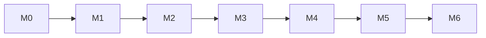

# Roadmap

Cada milestone entrega algo verificável e corresponde a uma versão. As issues estão nos
[milestones do GitHub](https://github.com/IgorPacheco1/Easy-finance/milestones); este documento
mostra a visão geral e o objetivo de cada etapa.

## Base do projeto (M0 a M3, concluída)

Os quatro primeiros milestones formaram a base: repositório organizado, backend funcionando, API
completa e um **PWA mínimo que já dá para usar localmente** (v0.3.0).

| Milestone | Versão | Objetivo | Entrega verificável |
|---|---|---|---|
| **M0: Fundação** | (nenhuma) | Repositório organizado como projeto profissional | Repo limpo, README honesto, CI ativo, ruleset na `main`, backlog criado |
| **M1: Esqueleto** | v0.1.0 | Base técnica do backend | Spring Boot sobe com Postgres (Docker Compose), Flyway aplica o schema, teste com Testcontainers passa no CI |
| **M2: Núcleo** | v0.2.0 | API de categorias e transações | API documentada (OpenAPI), com validação, erros padronizados, criação idempotente, saldo por período e testes |
| **M3: PWA mínimo** | v0.3.0 | Primeira interface usável | PWA instalável no celular: lançar gasto rápido, ver o mês e o saldo, gerenciar categorias (rodando localmente) |

## M4: Consultas e offline (v0.4.0, concluído)

**Objetivo:** encontrar e entender os lançamentos (filtros, busca e resumo por categoria) e
lançar mesmo sem internet.

**Entregue em 2026-11-09:** no celular, buscar lançamentos com filtros e rolagem infinita, ver no mês
o total por categoria e lançar sem conexão, com o envio automático quando a conexão voltar.

| Parte | O que entra |
|---|---|
| API | Paginação na listagem de transações; filtros por categoria, tipo, texto da descrição e faixa de valor; resumo por categoria no período; categorias ordenadas pelas mais usadas; `410 Gone` para o reenvio de uma transação já excluída |
| App | Tela de busca com filtros e rolagem infinita; resumo por categoria na tela do Mês; lançamento offline com fila e reenvio |
| Decisões | ADR da paginação (formato da resposta) e ADR do lançamento offline (spike) |

**Decisões do planejamento:**

- **Paginação por página** (`pagina` e `tamanho`) com rolagem infinita no app. É raro alguém
  lançar enquanto rola a lista; se acontecer, o app ignora o item repetido. A paginação por cursor
  fica como alternativa, registrada no ADR.
- **Offline só para lançar.** No aparelho ficam apenas as categorias e a fila de lançamentos ainda
  não enviados; cada lançamento sai do aparelho assim que o servidor confirma. Consultar dados
  offline guardaria o histórico financeiro no navegador sem login nem criptografia, por isso fica
  para depois do M5 (ver abaixo).
- **Reenvio de uma transação excluída:** o servidor guarda os ids excluídos e responde
  `410 Gone`; o app pergunta ao usuário se descarta o lançamento ou se lança de novo, com um id
  novo.
- **Editar e excluir transação no app** fica fora do M4, em issue própria.

## Foco atual: planejar o M5 (Segurança e multiusuário, v0.5.0)

**Objetivo:** cadastro, login e isolamento de dados por usuário. O M5 é planejado com o autor
antes de qualquer código. Pontos que já se sabe que entram (revisão de segurança de 2026-11-09):

- Toda consulta filtrada pelo usuário, inclusive as em SQL direto (resumo por categoria e
  categorias mais usadas) e a tabela de transações excluídas (senão o `410` revelaria que um id
  existiu na conta de outra pessoa).
- Senhas só com hash (BCrypt), limite de tentativas de login e sessão protegida.
- Sair da conta apaga os dados guardados no aparelho (fila offline e categorias).

## Depois do M5

| Milestone | Versão | Objetivo |
|---|---|---|
| **M6: Produção** | v1.0.0 | Imagem Docker, releases automatizadas, deploy, backups, monitoramento básico, cabeçalhos de segurança do app (CSP, HSTS) e limite de requisições |

Autenticação vem antes do deploy: dado financeiro real não vai para a internet sem login.

## Ideias para depois

Ideias já combinadas, sem milestone ainda. Cada uma tem a condição para entrar.

| Ideia | Quando |
|---|---|
| Consultar os dados offline com segurança (criptografados no aparelho e apagados ao sair da conta) | Depois do M5, porque depende do login |
| **Etapa de acabamento visual:** layouts mais sofisticados, identidade visual (cores, ícones, "a cara do app") e revisão da tela inicial (hoje Lançar, decisão provisória da #26) | Depois do M5. Até lá, o foco é deixar o app funcional |
| Layout próprio para o computador, aproveitando a tela grande | Na etapa de acabamento visual |
| **Modo demonstração:** o app publicado só no navegador, com dados de exemplo e API falsa (MSW), para qualquer pessoa experimentar por um link no README | Na etapa de acabamento visual, para a demonstração já sair com a cara final |
| Editar e excluir transação no app | Issue própria (#101), sem milestone; entra quando for priorizada |

## Ordem e dependências

Os milestones são sequenciais de propósito: cada um depende do anterior estar sólido.

## Como o roadmap é mantido

- Escopo de um milestone só muda por PR neste arquivo, com justificativa.
- Ao fechar um milestone: atualizar o [CHANGELOG](../CHANGELOG.md), criar a tag e a release.
