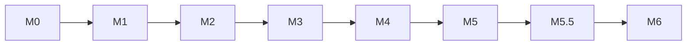

# Roadmap

Cada milestone entrega algo verificável e corresponde a uma versão. As issues estão nos
[milestones do GitHub](https://github.com/IgorPacheco1/Easy-finance/milestones); este documento
mostra a visão geral e o objetivo de cada etapa.

## Base do projeto (M0 a M3, concluída)

Os quatro primeiros milestones formaram a base: repositório organizado, backend funcionando, API
completa e um **PWA mínimo que já dá para usar localmente** (v0.3.0).

| Milestone | Versão | Objetivo | Entrega verificável |
|---|---|---|---|
| **M0: Fundação** | (nenhuma) | Repositório organizado como projeto profissional | Repo limpo, README honesto, CI ativo, ruleset na `main`, backlog criado |
| **M1: Esqueleto** | v0.1.0 | Base técnica do backend | Spring Boot sobe com Postgres (Docker Compose), Flyway aplica o schema, teste com Testcontainers passa no CI |
| **M2: Núcleo** | v0.2.0 | API de categorias e transações | API documentada (OpenAPI), com validação, erros padronizados, criação idempotente, saldo por período e testes |
| **M3: PWA mínimo** | v0.3.0 | Primeira interface usável | PWA instalável no celular: lançar gasto rápido, ver o mês e o saldo, gerenciar categorias (rodando localmente) |

## M4: Consultas e offline (v0.4.0, concluído)

**Objetivo:** encontrar e entender os lançamentos (filtros, busca e resumo por categoria) e
lançar mesmo sem internet.

**Entregue em 2026-11-09:** no celular, buscar lançamentos com filtros e rolagem infinita, ver no mês
o total por categoria e lançar sem conexão, com o envio automático quando a conexão voltar.

| Parte | O que entra |
|---|---|
| API | Paginação na listagem de transações; filtros por categoria, tipo, texto da descrição e faixa de valor; resumo por categoria no período; categorias ordenadas pelas mais usadas; `410 Gone` para o reenvio de uma transação já excluída |
| App | Tela de busca com filtros e rolagem infinita; resumo por categoria na tela do Mês; lançamento offline com fila e reenvio |
| Decisões | ADR da paginação (formato da resposta) e ADR do lançamento offline (spike) |

**Decisões do planejamento:**

- **Paginação por página** (`pagina` e `tamanho`) com rolagem infinita no app. É raro alguém
  lançar enquanto rola a lista; se acontecer, o app ignora o item repetido. A paginação por cursor
  fica como alternativa, registrada no ADR.
- **Offline só para lançar.** No aparelho ficam apenas as categorias e a fila de lançamentos ainda
  não enviados; cada lançamento sai do aparelho assim que o servidor confirma. Consultar dados
  offline guardaria o histórico financeiro no navegador sem login nem criptografia, por isso fica
  para depois do M5 (ver abaixo).
- **Reenvio de uma transação excluída:** o servidor guarda os ids excluídos e responde
  `410 Gone`; o app pergunta ao usuário se descarta o lançamento ou se lança de novo, com um id
  novo.
- **Editar e excluir transação no app** fica fora do M4, em issue própria.

## M5: Segurança e multiusuário (v0.5.0, concluído)

**Objetivo:** cada pessoa cria a própria conta, entra com e-mail e senha e só vê os próprios dados.
Escopo combinado no planejamento (#121), a partir da revisão de segurança de 2026-11-09.

**Entregue em 2026-11-15:** cadastro, entrar, sair, trocar a senha e excluir a conta; categorias e
transações isoladas por usuário; no app, telas de entrar, criar conta e "Conta", com a fila offline
ligada ao dono e apagada ao sair. O isolamento é provado por testes com duas sessões reais.

### Decisões do planejamento

- **Login por sessão no servidor com cookie** (`HttpOnly`, `Secure`, `SameSite`) e proteção CSRF,
  com Spring Security. JWT foi descartado: o token ficaria acessível ao JavaScript (risco com XSS),
  revogar é difícil e o service worker não teria o token para reenviar a fila offline. Os detalhes
  saem no ADR do spike.
- **Sessões guardadas no PostgreSQL** (Spring Session JDBC): reiniciar o backend não desloga
  ninguém, e trocar a senha consegue encerrar as sessões dos outros aparelhos.
- **Senhas só com hash BCrypt.** **Limite de tentativas de login** com um contador próprio, sem
  biblioteca nova.
- **Gestão de conta:** trocar a senha e excluir a conta com todos os dados (LGPD).
- **Dados de teste sem dono** no banco local são apagados pela migration do usuário (V4).

### Escopo, na ordem

| # | Issue | O que entrega |
|---|---|---|
| 1 | Spike: autenticação | ADR com sessão, cookie, CSRF, duração da sessão e reenvio da fila logado |
| 2 | Usuário e dono dos dados | V4: tabela `usuario`, `usuario_id` em todas as tabelas, índices por usuário |
| 3 | Cadastro | `POST /auth/cadastro`, BCrypt, e-mail único |
| 4 | Entrar, sair e sessão | Spring Security, Spring Session JDBC, `401` em ProblemDetail, `GET /eu` |
| 5 | Limite de tentativas | Bloqueio temporário por e-mail e por IP, `429` |
| 6 | Trocar senha e excluir conta | `PUT /eu/senha`, `DELETE /eu` e tela "Minha conta" |
| 7 | Categorias por usuário | Do sistema **ou** minhas, inclusive as mais usadas (SQL direto) |
| 8 | Transações por usuário | Listagem, filtros, saldo, resumo, `409` e `410` sem revelar dado de outra conta |
| 9 | App: entrar, criar conta e sair | Rotas protegidas, `401` leva ao login, sair apaga os dados do aparelho |
| 10 | Teste de isolamento | Usuário A tenta acessar os dados de B em **todos** os endpoints |
| 11 | Revisão de segurança e v0.5.0 | Checklist, documentação e release |

O modelo de dados vem antes do login porque o login precisa da tabela de usuário, e o isolamento
precisa da coluna `usuario_id`. O teste de isolamento é uma issue própria porque é o critério que
diz se o M5 está pronto.

### Fora do M5

- **"Esqueci a senha" e confirmar o e-mail:** precisam de um servidor de envio de e-mail, que é
  infraestrutura. Vão para o M6.
- **Limite de tentativas com mais de um servidor** e IP real atrás de proxy: no M6, com o deploy.
- **Consultar os dados offline:** continua em "Ideias para depois".

## M5.5: Acabamento (v0.6.0, em andamento)

**Objetivo:** antes de ir para produção, fechar as pendências técnicas e dar ao app a cara dele:
identidade visual com logo definitiva, design system, telas redesenhadas, layout para o computador
e um modo demonstração para mostrar o projeto. Escopo combinado no planejamento (#149).

Milestone extra entre o M5 e o M6: a Produção continua sendo o M6 (v1.0.0), como os ADRs 0020 a
0027 já registram.

### Decisões do planejamento

- **Revisão do projeto antes de planejar**, com foco em dívida técnica, estratégia de testes,
  acessibilidade (WCAG 2.1 AA) e design system. Os achados viraram issues:
  - Os tipos da API no app (`esquema.d.ts`) foram editados à mão na #130 e nada confere se batem
    com o backend: o CI passa a conferir isso.
  - No tema claro, a borda dos campos tem contraste de 1,2:1 e a cor de destaque, 2,2:1 (o mínimo
    para componentes é 3:1). O tema escuro passa em todos os pares.
  - O CSS tem cerca de 266 medidas escritas direto e 11 tamanhos de fonte; o tema só define cores.
  - O app não mede cobertura de testes nem verifica acessibilidade automaticamente.
- **Dependências novas, só de desenvolvimento:** `@vitest/coverage-v8` (cobertura do app) e uma
  biblioteca baseada no `axe-core` (testes de acessibilidade).
- **Identidade visual decidida num spike**, antes da logo e do design system: paleta (com
  contraste conferido), tipografia, conceito da logo e tela inicial (revisa a decisão provisória da #26).
- **Logo definitiva** em issue própria: a atual foi feita só para testar o PWA.
- **Redesenho em três issues**, por grupo de telas, para manter os PRs pequenos. Cada tela só fica
  pronta com o checklist de acessibilidade e os textos revisados.
- **Modo demonstração por último**, para sair com a cara final.
- **Fica para depois da Produção:** testar o app com pessoas e consultar os dados offline.
- **Teste ponta a ponta (E2E)** dos fluxos principais fica no M6, como verificação depois do deploy.

### Escopo, na ordem

| # | Issue | O que entrega |
|---|---|---|
| 1 | Detalhar o M5.5 (#149) | Este planejamento, issues e milestone |
| 2 | Versão 0.6.0-snapshot | `pom.xml` e `package.json` na próxima versão |
| 3 | Tipos do app conferidos no CI | Teste do backend gera o OpenAPI; o CI falha se os tipos do app estiverem diferentes (ADR) |
| 4 | Cobertura mínima no backend (#69) | `jacoco:check` |
| 5 | Cobertura do app | `@vitest/coverage-v8`, resumo no CI e piso mínimo |
| 6 | Paginação comum e saldo separado (#153) | Um hook de páginas para a Busca e o Mês; no Mês, o saldo carrega separado da lista, com erro próprio |
| 7 | Testes de acessibilidade | axe em todas as telas e checklist manual no CONTRIBUTING |
| 8 | Spike: identidade visual | ADR com paleta, tipografia, conceito da logo e tela inicial |
| 9 | Logo e ícones | Logo em SVG, ícones do PWA, cor do tema e logo no app e no README |
| 10 | Design system | Tokens (cores, tipografia, espaço, movimento), componentes base, contraste corrigido, sem `style` inline |
| 11 a 13 | Redesenho das telas | Lançar e Mês; Buscar e Categorias; Entrar, Criar conta e Conta |
| 14 | Editar e excluir transação (#101) | No app; a API já tem `PUT` e `DELETE` |
| 15 | Layout para o computador | Navegação lateral e listas mais largas, mesmo código |
| 16 | Modo demonstração | App no GitHub Pages com dados de exemplo e API falsa, link no README |
| 17 | Revisão e v0.6.0 | Revisão de acessibilidade, docs e release |

## Próximo: M6

| Milestone | Versão | Objetivo |
|---|---|---|
| **M6: Produção** | v1.0.0 | Imagem Docker, releases automatizadas, deploy, backups, monitoramento básico, cabeçalhos de segurança do app (CSP, HSTS), limite de requisições, envio de e-mail ("esqueci a senha" e confirmar o e-mail) |

Autenticação vem antes do deploy: dado financeiro real não vai para a internet sem login. O login
já existe (M5). O M6 é planejado com o autor **depois do M5.5**, antes de qualquer código.

**Limites aceitos no M5 que o M6 precisa tratar** (registrados nos ADRs e na revisão de segurança):

- IP real atrás de proxy (hoje o limite de login usa `getRemoteAddr()`) e limite de tentativas com
  mais de um servidor (ADR-0022).
- Cadastro sem limite de criações por IP e e-mail repetido revelando que a conta existe (`409`),
  aceito até haver confirmação de e-mail (ADR-0020).
- Cabeçalhos de segurança do app servido: CSP, HSTS, `frame-ancestors`, `Referrer-Policy` e
  `Permissions-Policy`. O app é compatível com CSP estrita, exceto o `style` inline da barra do
  resumo (`style-src-attr`), que sai no design system do M5.5.
- Fila offline sem criptografia no aparelho (ADR-0019): no M5 ela só é apagada ao sair.
- `id` UUID escolhido pelo cliente que já exista em outra conta responde `409`; a chave primária
  segue global (ADR-0026).

## Ideias para depois

Ideias já combinadas, sem milestone ainda. Cada uma tem a condição para entrar.

| Ideia | Quando |
|---|---|
| Consultar os dados offline com segurança (criptografados no aparelho e apagados ao sair da conta) | Depois do M6 (Produção) |
| Testar o app com 3 a 5 pessoas (teste de usabilidade) | Depois do M6: com o app em produção fica mais fácil chegar às pessoas |

A etapa de acabamento visual, o layout para o computador, o modo demonstração e editar e excluir
transação no app, que estavam aqui, entraram no M5.5.

## Ordem e dependências

Os milestones são sequenciais de propósito: cada um depende do anterior estar sólido.

## Como o roadmap é mantido

- Escopo de um milestone só muda por PR neste arquivo, com justificativa.
- Ao fechar um milestone: atualizar o [CHANGELOG](../CHANGELOG.md), criar a tag e a release.
