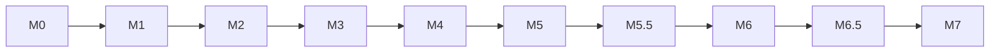

# Roadmap

Cada milestone entrega algo verificável e corresponde a uma versão. As issues estão nos
[milestones do GitHub](https://github.com/IgorPacheco1/Easy-finance/milestones); este documento
mostra a visão geral e o objetivo de cada etapa.

> **Numeração:** com o planejamento do Redesenho (#182), a Produção passou de M6 para **M7 (v1.0.0)**.
> Os ADRs 0004 a 0030 e as seções antigas deste arquivo citam a produção como "M6": leia como M7.
> Os ADRs não são editados, porque são o registro de quando cada decisão foi tomada.

## Base do projeto (M0 a M3, concluída)

Os quatro primeiros milestones formaram a base: repositório organizado, backend funcionando, API
completa e um **PWA mínimo que já dá para usar localmente** (v0.3.0).

| Milestone | Versão | Objetivo | Entrega verificável |
|---|---|---|---|
| **M0: Fundação** | (nenhuma) | Repositório organizado como projeto profissional | Repo limpo, README honesto, CI ativo, ruleset na `main`, backlog criado |
| **M1: Esqueleto** | v0.1.0 | Base técnica do backend | Spring Boot sobe com Postgres (Docker Compose), Flyway aplica o schema, teste com Testcontainers passa no CI |
| **M2: Núcleo** | v0.2.0 | API de categorias e transações | API documentada (OpenAPI), com validação, erros padronizados, criação idempotente, saldo por período e testes |
| **M3: PWA mínimo** | v0.3.0 | Primeira interface usável | PWA instalável no celular: lançar gasto rápido, ver o mês e o saldo, gerenciar categorias (rodando localmente) |

## M4: Consultas e offline (v0.4.0, concluído)

**Objetivo:** encontrar e entender os lançamentos (filtros, busca e resumo por categoria) e
lançar mesmo sem internet.

**Entregue em 2026-11-09:** no celular, buscar lançamentos com filtros e rolagem infinita, ver no mês
o total por categoria e lançar sem conexão, com o envio automático quando a conexão voltar.

| Parte | O que entra |
|---|---|
| API | Paginação na listagem de transações; filtros por categoria, tipo, texto da descrição e faixa de valor; resumo por categoria no período; categorias ordenadas pelas mais usadas; `410 Gone` para o reenvio de uma transação já excluída |
| App | Tela de busca com filtros e rolagem infinita; resumo por categoria na tela do Mês; lançamento offline com fila e reenvio |
| Decisões | ADR da paginação (formato da resposta) e ADR do lançamento offline (spike) |

**Decisões do planejamento:**

- **Paginação por página** (`pagina` e `tamanho`) com rolagem infinita no app. É raro alguém
  lançar enquanto rola a lista; se acontecer, o app ignora o item repetido. A paginação por cursor
  fica como alternativa, registrada no ADR.
- **Offline só para lançar.** No aparelho ficam apenas as categorias e a fila de lançamentos ainda
  não enviados; cada lançamento sai do aparelho assim que o servidor confirma. Consultar dados
  offline guardaria o histórico financeiro no navegador sem login nem criptografia, por isso fica
  para depois do M5 (ver abaixo).
- **Reenvio de uma transação excluída:** o servidor guarda os ids excluídos e responde
  `410 Gone`; o app pergunta ao usuário se descarta o lançamento ou se lança de novo, com um id
  novo.
- **Editar e excluir transação no app** fica fora do M4, em issue própria.

## M5: Segurança e multiusuário (v0.5.0, concluído)

**Objetivo:** cada pessoa cria a própria conta, entra com e-mail e senha e só vê os próprios dados.
Escopo combinado no planejamento (#121), a partir da revisão de segurança de 2026-11-09.

**Entregue em 2026-11-15:** cadastro, entrar, sair, trocar a senha e excluir a conta; categorias e
transações isoladas por usuário; no app, telas de entrar, criar conta e "Conta", com a fila offline
ligada ao dono e apagada ao sair. O isolamento é provado por testes com duas sessões reais.

### Decisões do planejamento

- **Login por sessão no servidor com cookie** (`HttpOnly`, `Secure`, `SameSite`) e proteção CSRF,
  com Spring Security. JWT foi descartado: o token ficaria acessível ao JavaScript (risco com XSS),
  revogar é difícil e o service worker não teria o token para reenviar a fila offline. Os detalhes
  saem no ADR do spike.
- **Sessões guardadas no PostgreSQL** (Spring Session JDBC): reiniciar o backend não desloga
  ninguém, e trocar a senha consegue encerrar as sessões dos outros aparelhos.
- **Senhas só com hash BCrypt.** **Limite de tentativas de login** com um contador próprio, sem
  biblioteca nova.
- **Gestão de conta:** trocar a senha e excluir a conta com todos os dados (LGPD).
- **Dados de teste sem dono** no banco local são apagados pela migration do usuário (V4).

### Escopo, na ordem

| # | Issue | O que entrega |
|---|---|---|
| 1 | Spike: autenticação | ADR com sessão, cookie, CSRF, duração da sessão e reenvio da fila logado |
| 2 | Usuário e dono dos dados | V4: tabela `usuario`, `usuario_id` em todas as tabelas, índices por usuário |
| 3 | Cadastro | `POST /auth/cadastro`, BCrypt, e-mail único |
| 4 | Entrar, sair e sessão | Spring Security, Spring Session JDBC, `401` em ProblemDetail, `GET /eu` |
| 5 | Limite de tentativas | Bloqueio temporário por e-mail e por IP, `429` |
| 6 | Trocar senha e excluir conta | `PUT /eu/senha`, `DELETE /eu` e tela "Minha conta" |
| 7 | Categorias por usuário | Do sistema **ou** minhas, inclusive as mais usadas (SQL direto) |
| 8 | Transações por usuário | Listagem, filtros, saldo, resumo, `409` e `410` sem revelar dado de outra conta |
| 9 | App: entrar, criar conta e sair | Rotas protegidas, `401` leva ao login, sair apaga os dados do aparelho |
| 10 | Teste de isolamento | Usuário A tenta acessar os dados de B em **todos** os endpoints |
| 11 | Revisão de segurança e v0.5.0 | Checklist, documentação e release |

O modelo de dados vem antes do login porque o login precisa da tabela de usuário, e o isolamento
precisa da coluna `usuario_id`. O teste de isolamento é uma issue própria porque é o critério que
diz se o M5 está pronto.

### Fora do M5

- **"Esqueci a senha" e confirmar o e-mail:** precisam de um servidor de envio de e-mail, que é
  infraestrutura. Vão para o M6.
- **Limite de tentativas com mais de um servidor** e IP real atrás de proxy: no M6, com o deploy.
- **Consultar os dados offline:** fica para depois da Produção.

## M5.5: Acabamento (v0.6.0, concluído)

**Objetivo:** antes de ir para produção, fechar as pendências técnicas e dar ao app a cara dele:
identidade visual com logo definitiva, design system, telas redesenhadas, layout para o computador
e um modo demonstração para mostrar o projeto. Escopo combinado no planejamento (#149).

Milestone extra entre o M5 e o M6: a Produção continua sendo o M6 (v1.0.0), como os ADRs 0020 a
0027 já registram.

### Decisões do planejamento

- **Revisão do projeto antes de planejar**, com foco em dívida técnica, estratégia de testes,
  acessibilidade (WCAG 2.1 AA) e design system. Os achados viraram issues:
  - Os tipos da API no app (`esquema.d.ts`) foram editados à mão na #130 e nada confere se batem
    com o backend: o CI passa a conferir isso.
  - No tema claro, a borda dos campos tem contraste de 1,2:1 e a cor de destaque, 2,2:1 (o mínimo
    para componentes é 3:1). O tema escuro passa em todos os pares.
  - O CSS tem cerca de 266 medidas escritas direto e 11 tamanhos de fonte; o tema só define cores.
  - O app não mede cobertura de testes nem verifica acessibilidade automaticamente.
- **Dependências novas, só de desenvolvimento:** `@vitest/coverage-v8` (cobertura do app) e o
  `axe-core` (testes de acessibilidade, com um ajudante próprio). Para o app, a fonte
  `@fontsource-variable/manrope` (#157).
- **Identidade visual decidida num spike**, antes da logo e do design system: paleta (com
  contraste conferido), tipografia, conceito da logo e tela inicial (revisa a decisão provisória da #26).
- **Logo definitiva** em issue própria: a atual foi feita só para testar o PWA.
- **Redesenho em três issues**, por grupo de telas, para manter os PRs pequenos. Cada tela só fica
  pronta com o checklist de acessibilidade e os textos revisados.
- **Modo demonstração por último**, para sair com a cara final.
- **Fica para depois da Produção:** testar o app com pessoas e consultar os dados offline.
- **Teste ponta a ponta (E2E)** dos fluxos principais fica no M6, como verificação depois do deploy.

### Escopo, na ordem

| # | Issue | O que entrega |
|---|---|---|
| 1 | Detalhar o M5.5 (#149) | Este planejamento, issues e milestone |
| 2 | Versão 0.6.0-snapshot | `pom.xml` e `package.json` na próxima versão |
| 3 | Tipos do app conferidos no CI | Teste do backend gera o OpenAPI; o CI falha se os tipos do app estiverem diferentes (ADR) |
| 4 | Cobertura mínima no backend | `jacoco:check` (#168; a #69, que pedia isso no M1, já estava fechada) |
| 5 | Cobertura do app (#152) | `@vitest/coverage-v8`, resumo no CI e piso mínimo |
| 6 | Paginação comum e saldo separado (#153) | Um hook de páginas para a Busca e o Mês; no Mês, o saldo carrega separado da lista, com erro próprio |
| 7 | Testes de acessibilidade | axe em todas as telas e checklist manual no CONTRIBUTING |
| 8 | Spike: identidade visual | ADR com paleta, tipografia, conceito da logo e tela inicial |
| 9 | Logo e ícones | Logo em SVG, ícones do PWA, cor do tema e logo no app e no README |
| 10 | Design system | Tokens (cores, tipografia, espaço, movimento), componentes base, contraste corrigido, sem `style` inline |
| 11 a 13 | Redesenho das telas | Lançar e Mês; Buscar e Categorias; Entrar, Criar conta e Conta |
| 14 | Editar e excluir transação (#101) | No app; a API já tem `PUT` e `DELETE` |
| 15 | Layout para o computador | Navegação lateral e listas mais largas, mesmo código |
| 16 | Modo demonstração | App no GitHub Pages com dados de exemplo e API falsa, link no README |
| 17 | Revisão e v0.6.0 (#163) | Revisão de acessibilidade, docs e release |

**Resultado:** tudo entregue na v0.6.0. A revisão de acessibilidade da release, no navegador real
(axe nas 8 telas, celular e computador, tema escuro, zoom de 200% e teclado), achou dois pontos,
corrigidos na própria #163: o item focado podia ficar atrás da barra inferior (WCAG 2.4.11) e a
faixa da demonstração estava fora das regiões da página. A demonstração está em
<https://igorpacheco1.github.io/Easy-finance/>.

## M6: Redesenho (v0.7.0, concluído)

**Objetivo:** antes da Produção, deixar o app com cara de produto e mais vivo, para a primeira
impressão de quem usar a v1.0.0 ser a de um app diferente. As quatro abas ganham uma versão nova,
desenhada e aprovada aba por aba em protótipos, e o repositório passa a apresentar o produto.
Escopo combinado no planejamento (#182).

### Decisões do planejamento

- **Redesenho antes da Produção:** a primeira impressão das pessoas próximas e da divulgação deve
  ser a do app novo. A Produção vira o **M7 (v1.0.0)**.
- **Cores por categoria:** paleta vibrante só para as categorias; a interface continua com a
  identidade Capital Cacau (ADR-0029). No tema claro, tons mais escuros com contraste de 3:1. A
  categoria é sempre identificada por **ícone + nome**, nunca só pela cor.
- **Ícone e cor guardados na categoria** (colunas novas), de uma **lista fechada** validada no
  backend. Ícones do `lucide-react` (ADR-0012).
- **Lançar como calculadora:** teclado numérico próprio, as 6 categorias mais usadas em grade e uma
  confirmação com o saldo do mês antes e depois. O teclado físico continua funcionando no computador.
  Depois do teste no celular, o teclado da tela deu lugar ao teclado do próprio celular (#216): o
  valor fica sempre à vista no topo.
- **Mês:** olho para esconder os valores, comparação com o mês anterior, gasto por dia, rosca por
  categoria e lançamentos agrupados por dia.
- **Conta vira perfil:** nome e avatar (iniciais e cor, **sem foto**: privacidade e sem
  armazenamento de arquivos), sequência de dias lançando e totais calculados. Tema e "esconder
  valores ao abrir" ficam **no aparelho**.
- **API nova ou alterada (aprovada):** ícone e cor nas categorias; nome e avatar no perfil
  (`/api/v1/eu/perfil`); quantidade de lançamentos no resumo; gasto por dia
  (`/api/v1/resumo/diario`); estatísticas da conta (`/api/v1/eu/estatisticas`). Perfil e
  estatísticas ficaram em `/api/v1/eu`, ao lado das outras rotas da pessoa logada (#193).
- **Movimento com limite:** animações curtas e sempre respeitando "reduzir movimento".
- **Repositório público mostra só o necessário:** README com cara de produto; este roadmap e o
  `CLAUDE.md` mostram o que foi entregue e o milestone em andamento.
- **Não pode piorar:** acessibilidade (WCAG 2.1 AA), cobertura mínima, velocidade de lançar,
  lançamento offline, layout do computador e modo demonstração.

### Escopo, na ordem

| # | Issue | O que entrega |
|---|---|---|
| 1 | Detalhar o M6 (#182) | Este planejamento, milestones M6 e M7, issues |
| 2 | Versão 0.7.0-snapshot | `pom.xml` e `package.json` na próxima versão |
| 3 | Paleta e ícones das categorias | Cores nos dois temas com contraste testado, lista de ícones, ADR |
| 4 | Ícone e cor da categoria no backend | Migration, validação, API, testes, ADR |
| 5 | Ícone e cor em todo o app | Telas mostram ícone e cor; demonstração atualizada |
| 6 | Lançar como calculadora | Teclado próprio, mais usadas, confirmação animada, desfazer |
| 7 | Mês: saldo, olho e comparação | Cartão novo, esconder valores, números que contam, comparação com o mês anterior |
| 8 | Gasto por dia | Endpoint diário e gráfico de barras |
| 9 | Rosca e lançamentos por dia | Rosca, maior gasto, lista agrupada; quantidade no resumo |
| 10 | Categorias redesenhadas | Lista nova, grade "sem movimento", abrir os lançamentos da categoria |
| 11 | Nova categoria e editar ícone e cor | Folha com prévia, ícones e cores |
| 12 | Nome e avatar no backend | Migration, cadastro com nome, perfil, ADR |
| 13 | Perfil e estatísticas na Conta | Cartão do perfil, sequência de dias, totais, trocar senha em tela própria |
| 14 | Preferências do aparelho | Tema manual e esconder valores ao abrir |
| 15 | Movimento e telas vazias | Transições, telas vazias, revisão do "reduzir movimento" |
| 16 | README com cara de produto | Apresentação do app, imagens, demonstração |
| 17 | Revisão e v0.7.0 | Revisão de acessibilidade no navegador real, docs e release |

### Ajustes depois de usar o app

Entraram no M6 antes da revisão, a partir do uso no celular e da comparação com os protótipos:

| Issue | O que entrega |
|---|---|
| Folhas fecham sozinhas (#215) | Folhas de categoria e perfil voltam a abrir no `npm run dev` (`StrictMode`) |
| Lançar com o teclado do celular (#216) | Valor no topo, teclado do sistema, dica para tocar no iPhone |
| Layout da Conta (#217) | Perfil centralizado, listas com ícones, instalar o app, privacidade em tela própria |
| Testes no `StrictMode` (#223) | Os testes de tela rodam como o app |

## M6.5: Guardá (v0.8.0, em andamento)

**Objetivo:** antes da Produção, dar ao projeto uma identidade própria. "Easy Finance" é um nome
genérico, difícil de achar e de registrar; o app passa a se chamar **Guardá**, inspirado no
lobo-guará, que já é o mascote. Trocar agora custa pouco; depois da Produção envolveria links
divulgados, domínio, e-mails e o app instalado nos celulares. Escopo combinado no planejamento de
2026-11-22, com protótipos no canvas.

### Decisões do planejamento

- **Nome:** Guardá. No código e nos endereços, sem acento: `guarda`.
- **Paleta Guará:** grafite, chumbo, areia e creme com o laranja do guará como destaque. Botões em
  Guará escuro (texto branco) no tema claro e Guará claro (texto grafite) no escuro, por contraste.
  A Manrope e as cores das categorias (ADR-0031) continuam.
- **Logo "espiando a moeda"** com a cara do mascote, numa versão só (também no favicon).
  Fica a versão simples até haver uma melhor.
- **Tudo com o nome novo:** pacote Java, artefato, `compose.yaml`, chaves do aparelho e o
  repositório (`Guarda`). A demonstração muda para `/Guarda/`, porque o Pages não redireciona.
- **Sem migração dos dados do aparelho e do banco local:** ainda não há usuários reais. O tema
  escolhido, a fila offline e o banco local de desenvolvimento começam do zero; o CHANGELOG avisa.
- **Histórico não muda:** ADRs antigos, entradas antigas do CHANGELOG, `legacy/` e `m0-pacote/`
  continuam com "Easy Finance".
- **Domínio:** a compra fica para o M7.

### Escopo, na ordem

| # | Issue | O que entrega |
|---|---|---|
| 1 | Detalhar o M6.5 | Este planejamento, milestone e issues |
| 2 | Identidade Guardá | ADR-0033 (substitui o ADR-0029), design system, pesquisa no INPI |
| 3 | Paleta Guará | Cores nos dois temas com contraste conferido |
| 4 | Logo e ícones | Logo nova, ícones do PWA e favicon |
| 5 | Nome no app | "Guardá" nas telas, manifest, chaves do aparelho e demonstração |
| 6 | Pacote e artefato do backend | `guarda` no pacote Java, pom, compose e banco local |
| 7 | Repositório e documentação | Repositório `Guarda`, demonstração, links, docs e imagens |
| 8 | Revisão e v0.8.0 | Revisão no navegador real, docs e release |

## Depois do M6.5

A **Produção (M7, v1.0.0)** é planejada com o autor depois da nova identidade, antes de qualquer código.
Os limites aceitos que ela precisa tratar estão registrados nos ADRs 0019 a 0027, e ela inclui uma
revisão de segurança antes de o app ser aberto para usuários.

## Ordem e dependências

Os milestones são sequenciais de propósito: cada um depende do anterior estar sólido.

## Como o roadmap é mantido

- Escopo de um milestone só muda por PR neste arquivo, com justificativa.
- Ao fechar um milestone: atualizar o [CHANGELOG](../CHANGELOG.md), criar a tag e a release.
